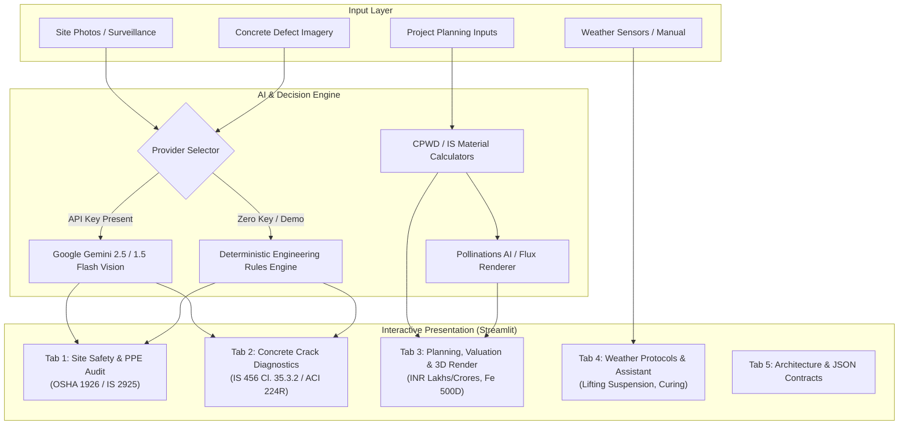

# Multimodal Construction Intelligence Platform

[](https://www.python.org/)
[](https://streamlit.io/)
[](https://ai.google.dev/)
[](https://docs.pytest.org/)
[](https://streamlit.io/cloud)
[](https://opensource.org/licenses/MIT)

> **Skill Wallet Capstone Project 1**  
> **Platform ID:** `6ac4c98d1dcde6d7857c1642`  
> **Category:** Generative AI | Real Estate Decision Support  

---

## Executive Summary & Scope

The **Multimodal Construction Intelligence Platform** is an enterprise-grade AI decision-support system tailored for civil engineers, site safety officers (EHS), project directors, and real estate developers. By harmonizing Google Gemini multimodal vision, CPWD material consumption benchmarks, Indian Standard civil codes (**IS 456:2000**, **IS 13920**, **IS 2925**, **IS 3521**), and US **OSHA 1926** safety standards, the platform provides automated, auditable decision support across the entire construction lifecycle.

The system requires **zero external database dependencies** and features an intelligent **graceful demonstration fallback mode**, ensuring 100% functional reliability even when operated offline or without an API key.

---

## Kanban Epics Implementation

| Epic | Designation | Implemented Modules & Deliverables | Verification Status |
| :--- | :--- | :--- | :--- |
| **Prerequisites** | Core Stack | Python 3.9+, Streamlit, FastAPI-ready modular structure | Passed |
| **Epic 1** | Requirements & Env | `requirements.txt`, `.env.example`, `.gitignore`, `pytest` test suite | Passed |
| **Epic 2** | PPE Vision & Crack Triage | Multimodal PPE compliance audit (OSHA/IS 456), defect classification (width, severity, repairs) | Passed |
| **Epic 3** | Planning & INR Valuation | Built-up sqft, Indian city tiers, Lakhs/Crores valuation, steel/cement metrics, Pollinations AI 3D rendering | Passed |
| **Epic 4** | Multimodal AI & JSON Contracts | Strict JSON schemas, programmatic validation, raw JSON viewer, downloadable reports | Passed |
| **Epic 5** | Site Chatbot & Weather Advisory | Dynamic climatic protocols (crane suspension, curing), multi-turn engineering chatbot | Passed |
| **Epic 6** | UI, Testing & Cloud Deployment | Clean CSS theme, comprehensive Pytest suite, 1-Click Streamlit Cloud ready | Passed |

---

## System Architecture



---

## Key Modules & Capabilities

### 1. Site Safety & Worker PPE Audit (Epic 2 & 4)
- **Surveillance Analysis:** Scans site photos for hard hats, high-visibility vests, steel-toe boots, and fall protection harnesses.
- **Regulatory Framework:** Evaluates hazards under **OSHA 1926 (Subparts E, M)** and Indian Standards (**IS 2925:1984**, **IS 3521:1999**, **IS 15298:2016**).
- **Hazard Remediation Matrix:** Automatically tags severity levels (*Low, Medium, High, Critical*) with step-by-step engineering remedies and standard citations.
- **Exportable Contract:** Instant download of `safety_audit_report.json`.

### 2. Concrete Crack Diagnostics & Structural Integrity (Epic 2 & 4)
- **Defect Typology:** Classifies concrete flaws into *Hairline*, *Settlement*, *Structural Shear*, *Thermal Expansion*, and *Spalling & Corrosion*.
- **Forensic Quantometrics:** Estimates crack width in millimeters (mm) and cross-checks against **IS 456:2000 Cl. 35.3.2** (maximum 0.3mm for moderate environmental exposure).
- **Remediation Blueprints:** Proposes targeted rehabilitation methods (low-viscosity epoxy pressure injection, CFRP composite laminates, micro-concrete re-profiling, tell-tale glass monitors).
- **NDT Recommendations:** Cites specific Non-Destructive Testing protocols (Ultrasonic Pulse Velocity IS 13311 Pt 1, Rebound Hammer Pt 2, Half-Cell Potential ASTM C876).

### 3. Project Planning, Material Estimation & Real Estate Valuation (Epic 3 & 4)
- **Indian City Tier Modeling:** Calibrated base construction rates across Tier 1 (Mumbai, Bengaluru, Delhi-NCR), Tier 2 (Pune, Ahmedabad, Kochi), and Tier 3 cities.
- **INR Denomination Formatting:** Automatic representation in Indian currency units:
  - `< INR 1,00,000`: `INR XX,XXX`
  - `INR 1,00,000` to `INR 99,99,999`: `INR XX.XX Lakhs`
  - `>= INR 1,00,00,000`: `INR XX.XX Crores`
- **CPWD Structural Material Estimations:**
  - **TMT Steel (Fe 500D):** Calculated in Kilograms, Metric Tonnes (MT), and Quintals.
  - **Cement (OPC 53 / PPC):** Calculated in Standard 50-kg Bags and Metric Tonnes.
- **Milestone Progress Tracker:** Visual phase milestones from Substructure Foundation to Superstructure, MEP, Finishes, and Handover.
- **Conceptual 3D Architectural Rendering:** Directly generates photorealistic concept visualizations via **Pollinations AI / Flux engine** with custom styling (Biophilic, Contemporary Indian, Brutalist, PEB Logistics).

### 4. Daily Site Assistant & Weather-Aware Advisory (Epic 5)
- **Dynamic Climatic Protocols:** Immediate safety procedures responding to:
  - **High Wind (> 38 km/h / 24 mph):** Mandatory tower crane shutdown, boom freewheeling weathervane mode (OSHA 1926.1431 / IS 4573).
  - **Heavy Rain / Monsoon:** De-energizing distribution boards, 30mA RCCB verification, and concrete pour suspension (IS 456 Cl. 13.3).
  - **Extreme Heat (> 40 C):** Chilled water/ice batching, night pour scheduling, and OSHA heat stress work-rest rotation.
- **Multi-turn Construction Assistant:** Persistent session chatbot answering technical queries on concrete curing times, stripping durations, slump testing, and seismic detailing.

---

## Directory Structure

```
Multimodal_Construction_Intelligence_Platform/
├── .streamlit/
│   └── config.toml               # Custom dark/amber industrial engineering theme
├── modules/
│   ├── __init__.py               # Package initializer
│   ├── ai_engine.py              # Dual Google GenAI SDK client & JSON sanitizer
│   ├── safety_audit.py           # PPE audit logic, OSHA/IS rules & contracts
│   ├── crack_diagnostics.py      # Crack defect triage, width & repair blueprints
│   ├── planning_valuation.py     # CPWD material math, INR currency formatting & Plotly
│   ├── architectural_render.py   # Pollinations AI / Flux prompt builder & live fetch
│   └── weather_assistant.py      # Climatic safety matrix & offline engineering KB
├── sample_data/
│   ├── sample_ppe_site.jpg       # Sample site photo for 1-click safety testing
│   ├── sample_crack_shear.jpg    # Sample RCC shear crack photo
│   └── sample_crack_hairline.jpg # Sample hairline curing crack photo
├── tests/
│   ├── __init__.py
│   └── test_platform.py          # 9 Unit & Integration tests (Pytest)
├── app.py                        # Turnkey Streamlit master application
├── requirements.txt              # Production dependency specifications
├── .env.example                  # Environment variable configuration template
├── .gitignore                    # Git exclusions
└── README.md                     # Comprehensive platform documentation
```

---

## Quickstart Guide

### 1. Clone the Repository
```bash
git clone https://github.com/your-username/Multimodal_Construction_Intelligence_Platform.git
cd Multimodal_Construction_Intelligence_Platform
```

### 2. Set Up Virtual Environment

**Windows (PowerShell):**
```powershell
python -m venv .venv
.\.venv\Scripts\Activate.ps1
python -m pip install --upgrade pip
pip install -r requirements.txt
```

**macOS / Linux:**
```bash
python3 -m venv .venv
source .venv/bin/activate
python -m pip install --upgrade pip
pip install -r requirements.txt
```

### 3. Run Automated Tests
Verify all engineering formulas, currency formatters, and JSON contracts:
```bash
python -m pytest tests/ -v
```

### 4. Launch Application
```bash
streamlit run app.py
```
Open your browser at `http://localhost:8501`.

---

## Gemini API Key Configuration

The platform operates in **Demonstration Mode** out-of-the-box without requiring any credentials.

To enable live multimodal computer vision:
1. Obtain an API key from Google AI Studio (https://aistudio.google.com/).
2. Either:
   - **Method A:** Paste the key into the **Sidebar** password field at runtime.
   - **Method B:** Create a `.env` file in the project root:
     ```env
     GEMINI_API_KEY=AIzaSyYourActualKeyHere
     ```

*Note: API keys entered in the UI are held strictly in temporary session memory and are never written to disk.*

---

## 1-Click Deployment to Streamlit Community Cloud

1. Push this repository to your GitHub account:
   ```bash
   git init
   git add .
   git commit -m "feat: complete Multimodal Construction Intelligence Platform turnkey release"
   git branch -M main
   git remote add origin https://github.com/<your-username>/Multimodal_Construction_Intelligence_Platform.git
   git push -u origin main
   ```
2. Navigate to https://share.streamlit.io/
3. Select your repository, set the branch to `main`, and main file path to `app.py`.
4. (Optional) Under **Advanced Settings > Secrets**, add:
   ```toml
   GEMINI_API_KEY = "AIzaSy..."
   ```
5. Click **Deploy!** The application will be live globally in under 2 minutes.

---

## JSON Data Contracts (Epic 4 Reference)

### Tab 1 Safety Audit Contract
```json
{
  "platform_id": "6ac4c98d1dcde6d7857c1642",
  "audit_timestamp": "2026-10-25T11:24:00Z",
  "safety_score": 88,
  "overall_status": "Compliant",
  "compliance_summary": "Strong baseline PPE adoption observed. 100% hard hat compliance.",
  "worker_count_estimate": 3,
  "ppe_detection": [
    {
      "item": "Safety Helmet / Hard Hat",
      "detected_count": 3,
      "missing_count": 0,
      "status": "Compliant",
      "standard_ref": "OSHA 1926.100 / IS 2925:1984",
      "risk_level": "Low",
      "observation": "All visible personnel wearing Type 1 Class E industrial hard hats."
    }
  ],
  "identified_hazards": [
    {
      "hazard_id": "HAZ-001",
      "hazard": "Temporary extension cord crossing pedestrian pathway without bridge",
      "category": "Access/Egress",
      "severity": "Low",
      "osha_ref": "OSHA 1926.416(e)(1)",
      "is_ref": "IS 5216",
      "corrective_remedy": "Install heavy-duty rubber cable protector bridge."
    }
  ]
}
```

---

## Engineering Disclaimer

This application is designed as an intelligent preliminary decision-support tool. Automated vision assessments and statistical planning estimations do not replace a physical inspection conducted by a licensed Structural Engineer, Chartered Quantity Surveyor, or certified Environmental Health and Safety (EHS) Officer. Curing, stripping, and safety protocols must be validated against local building bye-laws and structural contract drawings.

---

## Author & Credits

- **Skill Wallet Capstone Project 1**
- **Platform ID:** `6ac4c98d1dcde6d7857c1642`
- **Tech Stack:** Python 3.9+, Streamlit, Google Gemini Multimodal Vision, Plotly, Pillow, Pollinations AI / Flux.
